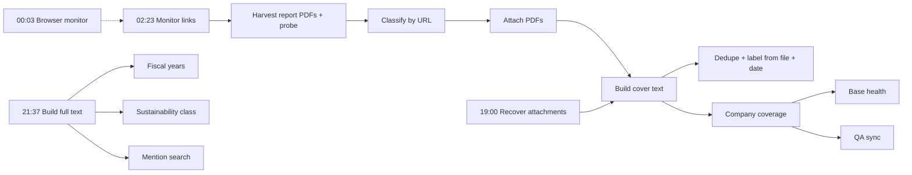

# Architecture

The pipeline turns about 36,500 monitored company web pages into a library of about 275,000 documents (October 2026), reads them, and tells one person per company what is still missing. Everything runs on GitHub Actions; the data lives in Airtable; nothing runs on a server of its own.

## Where the data lives

| Store | What it holds | Written by |
| --- | --- | --- |
| Airtable base **Disclosure Library** (`appXS0v6SnWdzAsY3`) | `companies` (2,000), `monitored_links` (pages), `report_library` (documents), `webpage_library` (printed pages), `mention_searches` and `mention_hits`, `base_health` (one row per day) | the scripts, and the owner through the interfaces |
| Airtable base **Pipeline QA** (`appJQ2mRtjHjzLq9E`) | `runs`, `failures`, `labels` (the golden set), `evals` | `qa.py` from the scripts, `qa_sync.py`, the daily and weekly Claude reviews, the owner |
| Airtable bases **Source Library 2024 / 2025** | the analysts' curated sources, with their own type and year | analysts. The pipeline only reads them |
| Text store (GitHub release assets of a private repository) | page-by-page full text of every readable report, 2021 onwards (70,000+ documents) | `build_fulltext.py` |
| `state/` in this repository | tombstones of deleted documents and pages, the hand-deletion archive | `purge_discarded.py`, `inbox.py` |
| Actions cache | the probe cache (`state/probe_cache.tsv.gz`) | `doc_probe.py` |

The Disclosure Library is capped at 500,000 records; `base_health` reports how full it is every day.

## The nightly chain (times UTC)

1. **Read pages.** `airtable_monitor.py` reads every page due that day with plain requests; `playwright_monitor.py` renders the pages that need a browser (JavaScript sites, bot walls), oldest first, 4,000 a night. Both keep `seen_links` (every document link ever seen on the page) and flag new ones.
2. **Harvest.** `harvest_reports.py` turns the document links of report-type pages into `report_library` rows, refusing documents already held (`doc_id`) or tombstoned. `doc_probe.py` opens links that do not look like files and keeps the ones that serve a PDF.
3. **Type and attach.** `classify_library.py` guesses a type from the address; `attach_files.py` asks Airtable to fetch each PDF; `recover_attach.py` downloads the ones Airtable could not and records why (`file_status`).
4. **Read.** `build_cover_text.py` reads the first six pages of every new file (`cover_text`, language, page count, content hash). Two Airtable AI fields then read `cover_text`: `source_type_check` (type, English documents only) and `source_title`.
5. **Clean and date.** `dedupe_library.py` discards duplicates and non-disclosures; `classify_library.py --from-file` titles and types from the file name and cover; `date_documents.py` sets `doc_year`.
6. **Measure.** `company_coverage.py` writes each company's completeness (six checks: report hub page, sustainability page, sustainability report 2024+, annual report 2024+, Code of Conduct, Human Rights Policy), its gaps, overdue reports and the work queue. `base_health.py` writes the day's row.
7. **Quality.** `qa_sync.py` turns the status fields into Pipeline QA failure rows and captures corrections.
8. **Full text** (separate chain, 21:37): `build_fulltext.py` reads every page of every report into the text store; `fiscal_years.py` reads the reporting year from it with a confidence score; `sustainability_class.py` reads where the sustainability disclosure lives (a dedicated report, embedded in the annual report, a specialized document, or financial only), the standards named and the assurance; `mention_search.py` answers the saved "which companies mention X" questions.

## The on-demand paths
- **Scan now** (`scan_now.py`, every 30 minutes, watching for 5.5 hours): ticking `scan_now` on a page runs the whole chain for that page in about 10 to 15 minutes. It also runs `inbox.py`, which handles `add_link`, `add_file`, `approve_suggestions`, `delete_now` and new mention searches.
- **Weekly:** regulator filings (SEC, ESEF annual reports for gaps, Monday 06:20), key figures (revenue, employees, Monday 09:20), page capture to PDF (Sunday 00:23).
- **Daily:** suggested pages for companies missing a hub (04:40), link and assign (07:03), base health (12:17).

## Claude tasks (scheduled outside GitHub)
- **Daily gap research** (weekdays 06:46 Madrid): searches the web for 25 companies' missing reports and pastes official links into `add_link`.
- **Daily QA review** and **weekly QA review**: see [quality.md](quality.md).
- **Weekly missed-reports audit**: paused since 20 Oct 2026; its job moves into the weekly QA review.
