# Diagrams

The whole system in pictures. Each diagram also appears in the owner's guide ([guide.md](guide.md)) and on the Notion page, next to the text it illustrates. Last updated 24 October 2026.

## 1. The map: where things live and who writes them

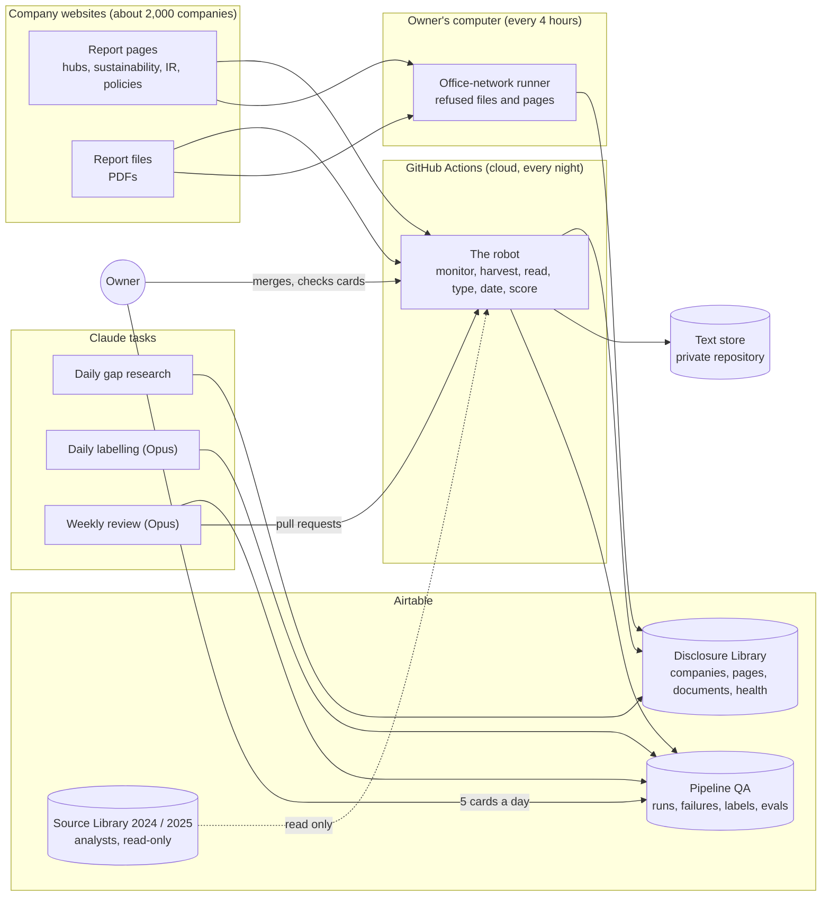

## 2. The life of one document

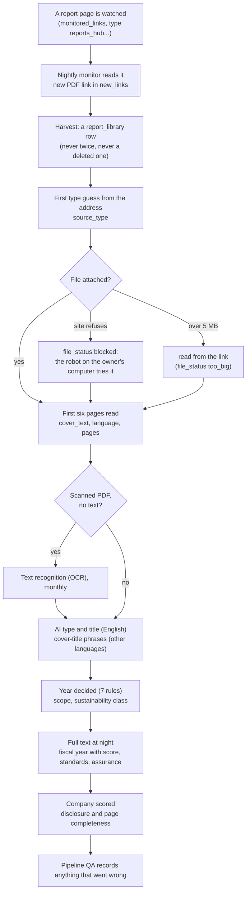

## 3. The night, hour by hour (Madrid time, winter)

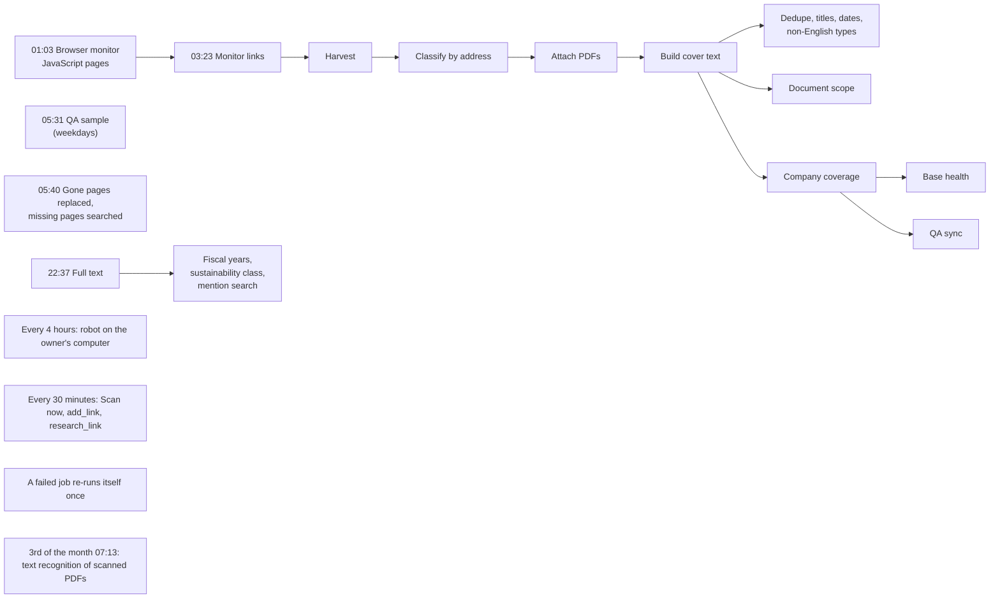

## 4. Which type is it? (the question order)

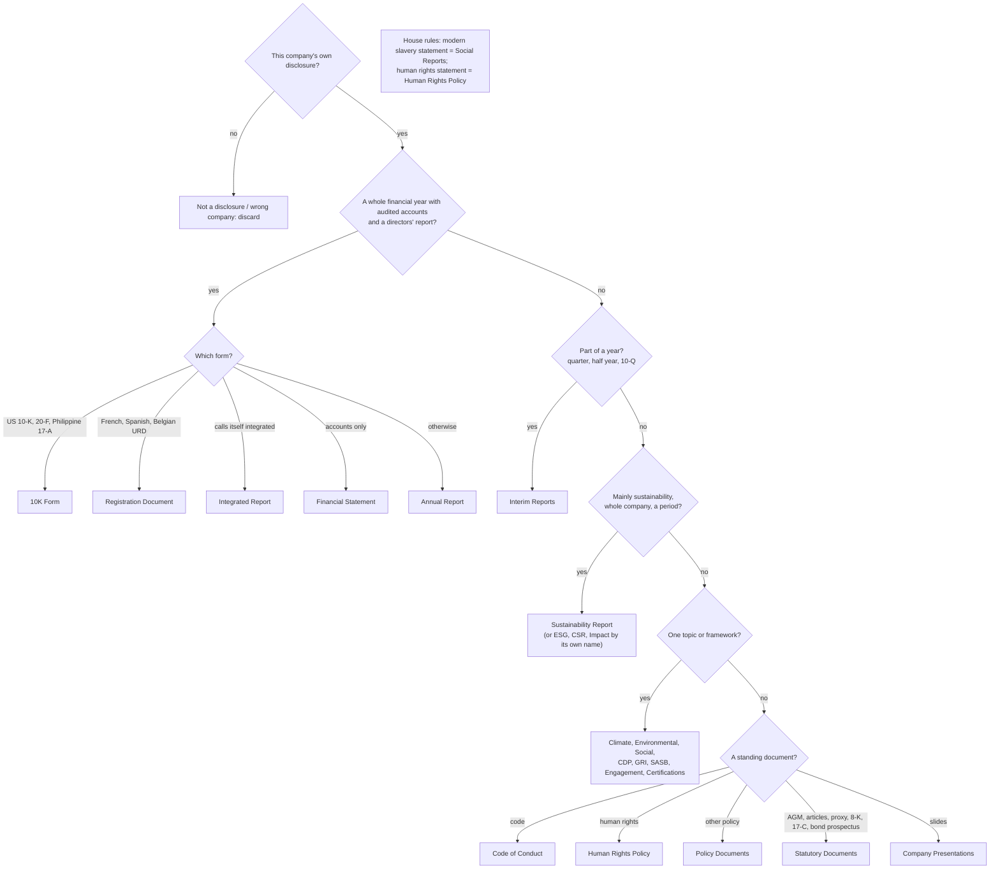

## 5. Which year is it? (first rule that applies wins)

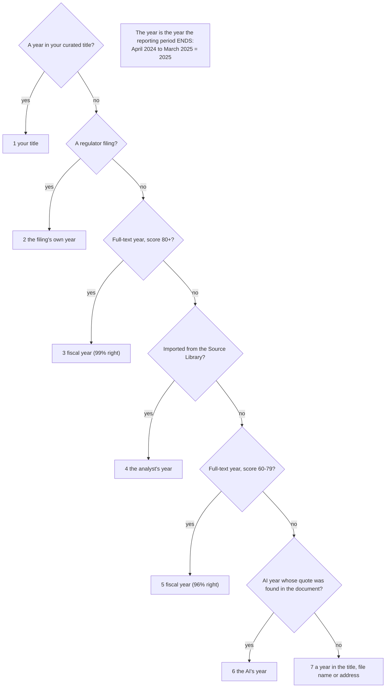

## 6. Completeness: six checks, two scores

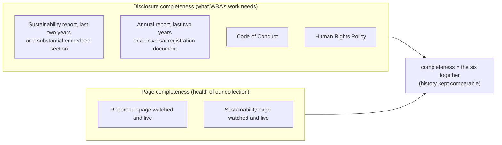

## 7. The quality loop

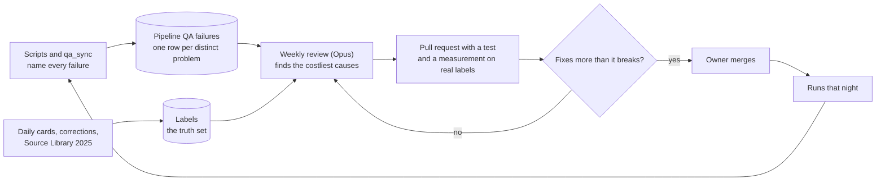

## 8. The daily cards: Claude labels, the owner checks about 5

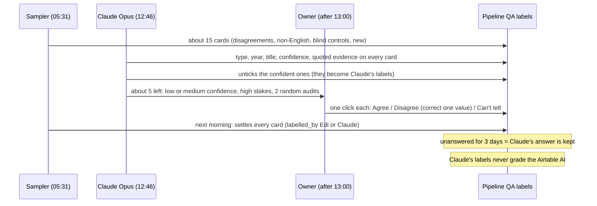

## 9. Files and pages a site refuses

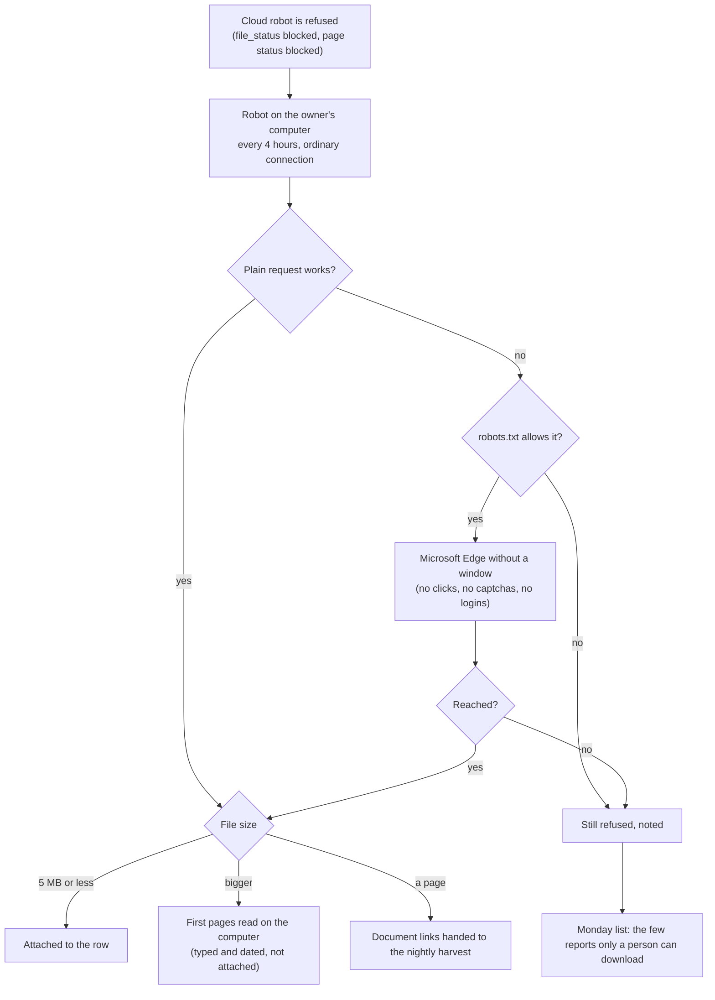

## 10. Who acts on each kind of failure

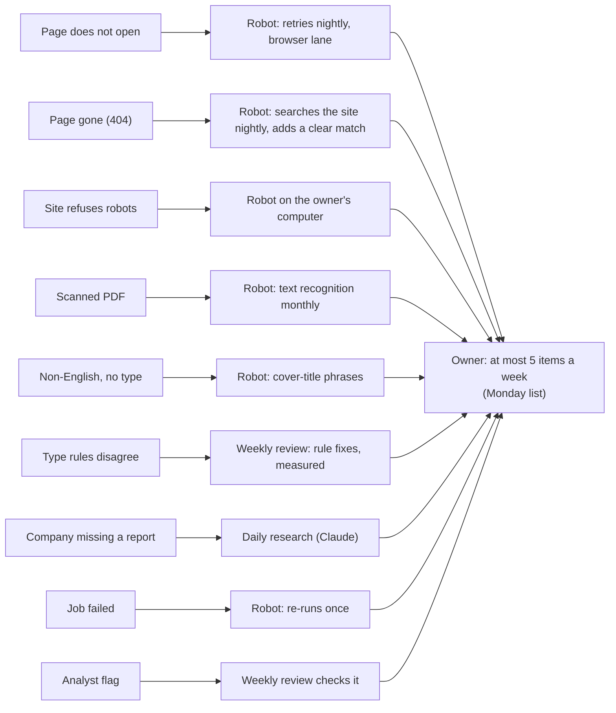

## 11. The daily research and how it is measured

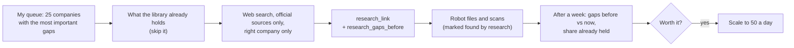
