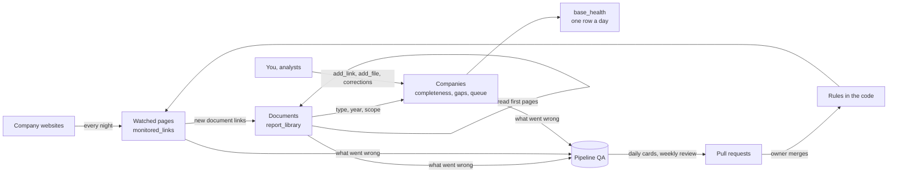

# Owner's guide

Start here. This page explains, in plain words, what the pipeline does, how a document travels through it, how to work in the two Airtable bases, what Pipeline QA is for, and what to do on a normal day. Every other document in `docs/` goes deeper on one part; the field-by-field reference is [fields.md](fields.md).

Last full review: 23 October 2026.

## 1. The whole thing in one paragraph

WBA assesses about 2,000 companies (the SDG2000). Each company publishes reports and policies on its website. The pipeline watches about 36,500 of those web pages every night, collects every report it finds into the Airtable base **Disclosure Library** (about 275,000 documents), reads the first pages of each one, decides what kind of document it is and which year it covers, and then scores each company on six checks ("does it have a recent sustainability report? a recent annual report? a Code of Conduct?..."). Everything runs by itself on GitHub Actions. A second base, **Pipeline QA**, records every way the pipeline fails and measures how often it gets types and years right, so that every change to the rules can be shown to help before it is merged. Claude writes all the code; the owner merges it.

## 2. The map

| Place | What it is | Who uses it |
| --- | --- | --- |
| **Disclosure Library** (Airtable, `appXS0v6SnWdzAsY3`) | The working base: companies, watched pages, documents, daily health. This is where things are fixed. | The owner, analysts (through the Analysts interface), the robot |
| **Pipeline QA** (Airtable, `appJQ2mRtjHjzLq9E`) | The quality log: every run, every failure, the labelled truth set, the scores. This is where problems are found and measured, never fixed. | The owner (Check Claude's answers), Claude's daily and weekly reviews, the robot |
| **Source Library 2024 / 2025** (Airtable) | The analysts' own curated sources from the assessment cycles. | Analysts. The pipeline only reads them, never writes. |
| **GitHub repository** `led2192/wba-link-monitor` (public) | The code, the scheduled jobs (Actions), and these docs. | Claude writes, the owner merges |
| **Text store** (a private GitHub repository) | The full text of every readable report since 2021, page by page, plus the monthly QA archive. | The robot (full-text jobs, mention search) |
| **Synced analyst base** | A separate base synced from a filtered view of report_library (whole reports with a file, or too big to attach and read from the link; universal registration documents included), for analysts who only need the finished documents. The view cannot be edited through the API while the sync depends on it: change its filters by hand in Airtable. | Analysts |

## 3. The life of one document

Take a 2024 sustainability report published on a company's "Reports" page.

1. **The page is watched.** The page is a row in `monitored_links` with `type` = `reports_hub` and `monitor` ticked. Only five page types are harvested for documents: `reports_hub`, `sustainability_page`, `sustainability_report`, `investor_relations`, `policies`. A report page typed `news` or `other` is read but never harvested, which is why a wrong page type means missed reports.
2. **The new link is seen.** The nightly monitor (02:23 UTC, plus a browser monitor at 00:03 and 12:03 for JavaScript sites) reads the page, adds the PDF link to `seen_links` and, because it is new, to `new_links`.
3. **A document row is created.** The harvester turns the link into a `report_library` row with a stable `library_id`. It refuses links already held (same normalized address) and links on the deletion list (tombstones), so a re-run never duplicates.
4. **First guess of the type, from the address.** `source_type` is guessed from the words in the link (for example `/sustainability-report-2024.pdf`). This is opinion number one. Never edit it.
5. **The PDF is attached.** Airtable fetches the file into `file`. If the site refuses, a second job downloads it itself; if that fails too, `file_status` says why: `blocked` (the site refuses robots), `gone` (404), `not_pdf`, or `too_big` (over Airtable's 5 MB upload limit). Files too big to attach are still read from `document_url`; they just have no attachment.
6. **The first six pages are read.** `cover_text`, `page_count`, `doc_language` and `content_hash` are written. A scan with no text (`cover_status` no_text) is read by text recognition once a month (`cover_ocr` ticked). Two Airtable AI fields then read `cover_text` (English documents only): `source_type_check` (opinion number two, the AI type) and `source_title`.
7. **The effective type.** `effective_type` = the AI type when there is one, else the address type. This is the type every count and check uses. When you correct a type, you change `source_type_check`.
8. **Clean-up.** Duplicates (same file, same address) and non-disclosures (insider-trading forms, call transcripts) are discarded with a `discard_reason`. Nothing is deleted at this stage.
9. **The year.** See section 6.2. The field to trust is `year`; `year_source` says which rule decided it.
10. **Scope and sustainability class.** `scope` says whether the file is a whole report, part of one, or a summary. `sustainability_class` says where the sustainability content lives: D dedicated report, E embedded in an annual report, S specialized (one topic), F financial only.
11. **Full text.** At 21:37 UTC every page of every report since 2021 goes into the text store. From it, `fiscal_year` (with `year_score` and `year_evidence`), `sustainability_class`, `frameworks` and `assurance` are refined, and saved "which companies mention X" searches are answered.
12. **The company is scored.** `company_coverage.py` recomputes the company's `completeness`, `gaps`, `overdue_reports`, `sust_reporting` and its place in the work queue. The new report now passes the "sustainability report (recent)" check.
13. **Quality.** `qa_sync.py` records anything that went wrong along the way as a failure in Pipeline QA, and takes a snapshot of what the robot decided (`robot_type`, `robot_year`, `robot_title`) so that a later human correction can be recognised and learned from.

The same journey runs on demand in 10 to 15 minutes when you tick `scan_now` on a page, paste a link in `add_link`, or drop a PDF in `add_file`.

## 4. Your routine

### Every weekday (about 15 minutes)
1. **Base health** (Disclosure Library, interface "Base health", page Health, or the `base_health` table, top row). Read `status` and `attention`. OK = nothing to do. Check = the base is over 80% full or nothing new arrived. Problem = a job failed twice (it re-runs itself once first; `failed_jobs` links it) or the base is over 90% full. Nothing to do: the weekly review reads it. Average completeness is the headline number.
2. **Check Claude's answers** (Pipeline QA), after 13:00 Madrid: about 5 cards, one click each (Agree, Disagree, Can't tell). Section 7.4.
3. **Notifications from Claude.** The 06:46 gap research tells you which companies it researched and which links it pasted. The 12:46 labelling tells you how many cards it labelled, how many it left for you and any pattern it saw.
4. **Optional:** the queue on interface Hoy (Analyst and Action filters) when you have time to chase a missing report by hand.

### Every Monday
1. Read the weekly review's notification (08:47 Madrid). It lists the pull requests to merge, the causes found and anything that needs you.
2. Merge the pull requests it opened, one at a time, after checking that the Tests check is green and reading the measurement comment (section 8). If two pull requests conflict, merge the first and ask Claude to update the second.
3. Do the "Para ti esta semana" items, if any (at most 5).
4. Look at the week in `base_health` (completeness trend, failed jobs) and at the companies whose `completeness_change` is not empty: those lost a check during the week, and the field says which document used to pass it and what happened to it.

### When the Monday list has items for you
At most 5 a week (section 7.2). Analyst flags, if any come, are checked by the weekly review first; it lists the ones it cannot settle.

### Monthly
Nothing by hand. On the 1st the QA archive moves old closed failures out of Pipeline QA. When `base_health.base_full` passes 80%, run Purge discarded rows (dry run first).

## 5. The Disclosure Library

### 5.1 Tables

| Table | One row per | What matters most |
| --- | --- | --- |
| `companies` | company (2,000) | `completeness`, `gaps`, `overdue_reports`, `sust_reporting`, the work queue fields, and your input boxes `add_link`, `add_file` |
| `monitored_links` | watched web page (about 36,500) | `type`, `monitor`, `status`, `possible_issue`, `scan_now`, `scan_concern` |
| `report_library` | document (about 275,000, discarded included) | `doc_label`, `effective_type`, `source_type_check`, `year`, `file`, `file_status`, `scope`, `discard` |
| `webpage_library` | web page printed to PDF (pages ticked `capture_page`) | captured every Sunday |
| `mention_searches`, `mention_hits` | a saved "which companies mention X" question, and each matching document | see `TEXT_SEARCH.md` |
| `base_health` | night | the daily health row |
| `company_contacts` | company and email address printed in its own key reports (from 27 Oct 2026) | `email`, `kind` (investor relations, sustainability, media, general, ethics and compliance, privacy, people, personal, other), `personal`, `evidence` (page and sentence), `last_seen`, `domain_mail` (does the domain accept mail at all, from DNS; the mailbox itself cannot be checked without writing). Written by `contacts.py`; never deleted. Prefer the role mailboxes: a personal address is a person's data the company published for contact |

### 5.2 Interfaces

| Interface, page | What it is for |
| --- | --- |
| **Hoy** (new, 26 Oct 2026) | The one page to open each day: key reports per company (latest and previous wave), the work queue with Analyst and Action filters (opens the company's to-do page), health over time (companies with both key reports, one, neither), and when companies publish their key reports (section 6.9) |
| **Empresas** (new, 26 Oct 2026) | One list of the 2,000 companies with key reports as the main measure, filters by analyst and wave status; a Gaps section with tabs (report overdue, key pages not found, no pages watched, neither key report). A company opens its key reports page, where `add_link` and `add_file` are |
| **Páginas** (new, 26 Oct 2026) | Watched pages in one place: pages that may be missing documents (not harvested, no document links, does not open, scanned by hand) and the on-demand scan (waiting, scanned recently, added this week) |
| **Base health**, Health | Rebuilt 24 Oct 2026: numbers and charts of the three averages (completeness, disclosure completeness, page completeness), how full the base is, new documents per day; the daily rows; every company with its three scores |
| **Base health**, My queue | Your work list: companies ordered by `queue_score` (how much fixing them matters), with `queue_item` saying the one thing to do. Snooze a company with `queue_snooze_until` when it really has not published |
| **Base health**, Overdue reports | Companies whose next report should be out by their own rhythm and is not held |
| **Base health**, Pages to check | Report pages with 3 or more document links whose documents are not in the library |
| **Base health**, Scan pages | Pages waiting for an on-demand scan, and their results |
| **Coverage**, Coverage dashboard, Missing key sources, Source gaps | Companies by gap type, for planning |
| **Source Review**, My portfolio, Add URL | A portfolio view per analyst, and a form to add a page |
| **Analysts**, Companies, Flagged documents | Shared with analysts (interface-only access). They see each company's documents and pages, may add links and files, and may flag documents that look wrong. A bonus: nothing depends on analysts doing it. A flag never changes a row; you decide |
| **Mentions**, Review, Searches | The mention searches and their hits, for review |

Hoy, Empresas and Páginas replace Base health (except Health), Coverage, Source Review and the Analysts company list, which measured the same gaps five different ways (`coverage_flags`, `missing_types`, `completeness` with `gap_pages`, `overdue_reports`, `kr_latest_status`). The old interfaces stay until the owner has checked the new ones and removes them by hand; nothing in the pipeline depends on them. Mentions, Pipeline QA and the Analysts interface (documents, flags) stay.

### 5.3 The few fields you edit

Everything else is written by the robot or computed. The full list, with who writes each field, is in [fields.md](fields.md).

**On a company**
- `add_link`: paste any link you found, one per line (a PDF or a page). Within minutes the robot checks that it is new and reachable, files it, scans it, and answers in `add_result` with its first guess of type and year. If the site refuses robots, nothing is added and `add_result` asks you for the file.
- `add_file`: drop a PDF you downloaded yourself because the site blocks the robot. If the library already holds that document's link without a file, the file goes onto that row.
- `website`: for a new company. The robot searches the site: a clear best page (one candidate with 3+ document links, or twice the links of the next) is added automatically; ambiguous candidates wait in `suggested_links`, where you may delete wrong lines and tick `approve_suggestions` (optional; the weekly review also looks at them).
- `queue_snooze_until`: the company really has not published; it leaves the queue until that date.
- `analyst`, `adopted_on`, `Notes`, `key_figures_checked`.

**On a page** (`monitored_links`)
- `type`: fix it when wrong (a report page typed `news` is never harvested).
- `monitor`: untick junk (job boards, third-party sites). The row stays on record.
- `scan_now`: scan this page now. `scan_concern`: write what looks wrong; the weekly review answers in `audit_reply`.
- `capture_page`: the page itself is a disclosure (a policy written as a web page); it is printed to PDF every Sunday.
- `certified`: you confirmed it is the right page for its type.
- `delete_now`: delete for good (archived and blocked first).

**On a document** (`report_library`)
- `source_type_check`: the type, when it is wrong. The correction is captured automatically and becomes a label in Pipeline QA.
- `curated_doc_title`: the real title, copied verbatim from the cover. It wins over every other title and its year wins over every other year.
- `discard` + `discard_reason`: the row should not count (duplicate, wrong company, not a disclosure, out of scope, unusable file). Reversible for 30 days; after that the purge deletes it.
- `delete_now`: delete now (archived and blocked forever, so the robot never brings it back). Verified rows are never deleted.
- `verified`: the row is right as it stands; this freezes it against reprocessing.
- `analyst_flag`: clear it once you have handled an analyst's flag.

## 6. How the robot decides

### 6.1 Type
Two opinions: the address (`source_type`, rules in `classify_library.py` and `source_type_terms.json`) and the AI over the first pages (`source_type_check`, English documents only). The AI wins when it has answered (`effective_type`). A document neither of them typed (mostly non-English) is typed from its file name and its cover title, including cover-title phrases in other languages (`cover_terms.json`: "Relatório de Sustentabilidade", "Nachhaltigkeitsbericht", "統合報告書", "年度报告"...); `match_confidence` then says "cover title". `type_mismatch` = 1 marks rows where the two disagree; when the disagreement moves a completeness check, it becomes a TYPE_DISAGREE failure, and some of those become review cards.

There are 24 types plus "Not a disclosure". The question order that settles most documents:

1. **Is it this company's own disclosure?** A document by someone else, a news article, a job ad, an insider-trading form: discard (Not a disclosure, or Wrong company).
2. **Does it cover a whole financial year and contain the audited accounts and the directors' report?** It is an annual-family document:
   - US Form 10-K or 20-F, Philippine SEC Form 17-A: **10K Form**.
   - French, Spanish or Belgian universal registration document (URD, document d'enregistrement universel): **Registration Document** (counts as the annual report when it is 100+ pages; see 6.4).
   - Titled or built as one report combining the financial and the sustainability story ("Integrated Report", "Integrated Annual Report"): **Integrated Report**.
   - Otherwise: **Annual Report**. Only the accounts, without the narrative: **Financial Statement**.
3. **Does it cover part of a year?** Quarterly or half-year results, Form 10-Q, quarterly statements, Indian integrated filings: **Interim Reports**.
4. **Is it mainly about sustainability, for the whole company, for a period?** **Sustainability Report**, or ESG / CSR / Impact Report when that is what it calls itself.
5. **Is it about one topic or one framework?** Climate Report (TCFD), Environmental Reports, Social Reports, CDP Report, GRI index, SASB Index, Engagement Report, Certifications.
6. **Is it a standing document without a period?** Code of Conduct; Human Rights Policy; any other policy: Policy Documents. Legal and market filings (AGM notices, articles, proxy statements, governance statements, current reports such as SEC 8-K or Philippine 17-C): **Statutory Documents**. Slides: **Company Presentations**.

House rules (owner's decision, 23 Oct 2026):
- A **modern slavery statement** is a **Social Report**, even when it also covers human rights.
- A **human rights statement** without modern slavery content is a **Human Rights Policy**.

Fits nothing: UNKNOWN. Unsure between two: pick the closer one and untick `sure` on the card.

### 6.2 Year
The year is the year in which the reporting period **ends** (April 2024 to March 2025 is 2025; calendar 2024 is 2024). Policies usually have none. The `year` formula takes the first of these that applies, and `year_source` says which:

1. a year in your `curated_doc_title`;
2. a regulator filing's own year;
3. `fiscal_year` read from the full text with `year_score` 80 or more (right 99% of the time against the analysts' years);
4. the analyst's year, for documents imported from the Source Library;
5. `fiscal_year` with `year_score` 60 to 79 (about 96% right);
6. the AI's year, only when the sentence it quoted was found in the document (`ai_year_verified`);
7. `year_rules`: a year in the AI title (ignoring bond maturity dates and years after `doc_year` + 1), else `doc_year` from the file name, cover or address.

`year_evidence` holds the sentence that decided `fiscal_year`, so a year can be checked without opening the PDF. Comparison periods ("the preceding year ended ...") and ten-year tables are ignored as evidence.

**The fiscal year for research (from 27 Oct 2026).** The attribute research team counts a fiscal year that ends January to June as the previous year, and one that ends July to December as that year: the year ended 31 January 2026 is FY2025, the year ended 30 June 2025 is FY2024, the year ended 31 March 2026 is FY2025, the year ended 31 December 2025 is FY2025. `fiscal_year_wba` on each document follows that rule for the fiscal year the document belongs to: the company's usual year-end month (`companies.fy_end_month`, written nightly by key_reports.py from its long annual reports) places the document's `period_end` in a fiscal year, so a half-year report ending June 2025 of a December company belongs to FY2025, not FY2024 (ACCIONA's first-semester sustainability report, 27 Oct 2026). Until that month is known the document's own period end is used; documents with no month in `period_end` use `year` with the company's month. `year` itself stays the year the period ends, because the completeness checks, the key report waves and the analysts' views were built on it; use `fiscal_year_wba` wherever a benchmark year is meant. The key report waves already match the rule: wave P (periods ending July P-1 to June P) holds fiscal year P-1.

### 6.3 Title
`doc_label` (year, company, title) uses `curated_doc_title` when you set one, else the AI's title (`ai_title`: `source_title` unless the AI answered with a sentence such as "I don't have access to the document text"), else the robot's `auto_title`. An "[auto]" prefix means a title was constructed, not read.

### 6.4 Completeness (rules v3, live since 24 Oct 2026)
Six checks, each worth one sixth of `completeness`:

| Check | Passes when |
| --- | --- |
| Report hub page | a monitored page of type `reports_hub` |
| Sustainability page | a monitored page of type `sustainability_page` (or `sustainability_report`) |
| Sustainability report (recent) | a sustainability-family document (Sustainability, ESG, CSR, Integrated or Impact Report) for the last two years; **or** an embedded section: a whole Annual Report, 10-K or URD with `sustainability_class` E and either 8+ consecutive sustainability pages or a contents entry naming a sustainability statement or BRSR |
| Annual report (recent) | an annual-family document (Annual Report, Integrated Report, 10K Form) for the last two years; **or** a URD: type Registration Document, 100+ pages, a title naming a registration document or annual report, no bond, prospectus or amendment words (`is_urd` = 1) |
| Code of Conduct | any Code of Conduct, any year |
| Human Rights Policy | any Human Rights Policy, any year |

Since 24 Oct 2026 (rules v3) the two page checks count only pages still watched that have not gone (404/410); an unticked or gone page no longer passes.

Two scores split the six checks (owner's request, 23 Oct 2026): `disclosure_completeness`, the four document checks (what the company publishes and we hold, the number that matters for WBA's work), and `page_completeness`, the two page checks (whether we watch its pages: the health of our collection). `completeness` stays the six together, so its history remains comparable; `base_health` reports all three averages.

`sust_reporting` says how the company reports sustainability for 2024 onwards: `dedicated`, `embedded`, `both` or `none`. `check_docs` records which document passes each check, and `completeness_change` explains a check lost overnight. `overdue_reports` flags a sustainability or annual report that, by the company's own rhythm, should be out (reports for a year are expected from July of the next year).

### 6.5 The work queue
`queue_score` ranks companies by how much their top problem matters (mainly missing 2024+ sustainability and annual reports); `queue_item` says the one thing to do and `queue_action` its kind (Find the report, Find the report (site blocks robot), Find the report page, Review suggested pages, Add the website, Find the policy). The daily gap research takes 25 companies a day from the top of this queue.

### 6.6 Evidence passages (from 24 Oct 2026)
A first step towards extracting information for the Integrated Transition Assessment. Every 2024+ report with full text (annual, integrated, sustainability family, financial statements, interim reports, presentations, single-topic reports) is cut into passages of about 120 words (never across pages), and a passage is kept as evidence when it names at least three distinct phrases of one dimension, or two from two different topics of it. The phrases follow the white paper's grid (Appendix D, Table D.1):

| | Climate | Nature | Social |
| --- | --- | --- | --- |
| Topics | targets, emissions, transition plan, decarbonisation levers, climate finance, climate risk | dependencies and impacts (TNFD), biodiversity, land and forests, water, pollution, mitigation hierarchy | human rights, living wage, health and safety, grievance and remedy, affected stakeholders, equity, just transition, responsible AI |

A fourth group, **financial** (since 24 Oct 2026), holds income (revenue, EBITDA, net income), balance sheet, investment (capex, R&D, acquisitions, dividends), structure (subsidiaries, segments, employees, stores) and reporting words, for figures such as revenue and employees that may come from any kind of report.

Each passage also gets an area (planning: targets, commitments, governance; implementation: actions, investment, due diligence, engagement; performance: a stated quantity or change), the integration aspects it names (strategy coverage, integrated governance, cross-dimension, value chain, AI and digital) and its page. Passages live in the private text store; `evidence_profile` on the document says how many there are per dimension and area. Running page headers and contents pages are dropped. The lexicon is `evidence_terms.json`: change a phrase there and every document is tagged again. Nothing here scores a company; it is the index a later extraction tool will read from. English phrases only for now.

### 6.7 Key reports (from 24 Oct 2026)
The overview the owner asked for: for every company, do we hold the long annual report(s) with its full-year financial data and its full-year sustainability data, first for the reports published this year, then for last year's?

- **Waves.** Wave P is every report whose period ends between July of P-1 and June of P, so in 2026: calendar-2025 reports and fiscal years such as April 2025 to March 2026; the 2025 wave is calendar 2024 and fiscal years ending July 2024 to June 2025. The period end is `period_end` when it has a month, else the year with the company's usual year-end month.
- **Financial data**: an annual report, integrated report, 10-K or 20-F, a universal registration document, or (last resort) a financial statement of 15+ pages. **Sustainability data**: a sustainability, ESG, CSR, integrated or impact report, or an annual report with a substantial sustainability section (the same rule as completeness). One report carrying both is preferred.
- **Never counted**: parts of a report, summaries, annual reports under 40 pages, and reports of a subsidiary. The subsidiary check (`entity_check`) reads the title and the first legal name on the cover: "Roche Capital Market Ltd", "Taipei Fubon Commercial Bank", "DNB Boligkreditt" are subsidiaries; "PUMA SE", "HSBC Holdings plc", a title saying "DNB Group" are the group; no legal name found is `unclear` and still counts. Correct `entity_check` by hand when it is wrong: your value stands.
- **On each company**: `kr_latest_status` and `kr_prev_status` (Both in one report, Financial and sustainability separate, Financial only, Sustainability only, None), links to the chosen reports, and `kr_note` in words. `base_health` counts companies whose latest wave is complete, partial, only in the previous wave, or in neither.
- First measurement (24 Oct 2026, 2,000 companies): 2026 wave complete for 855 (43%), partial for 530, only the 2025 wave for 353, neither for 262; 263 candidate reports left out as subsidiaries (Roche Capital Market, Fubon's bank, insurers and broker, Sun Pharma's country companies, DNB Boligkreditt).

### 6.8 Publication dates (from 24 Oct 2026)
When was a key report published? `pub_date` holds the answer as far as the evidence goes, `pub_date_precision` says day or month, `pub_date_source` says what decided it and `pub_date_evidence` quotes the sentence and page. The order, strongest first:

1. **regulator filing**: the SEC or ESEF filing date, also for a 10-K, 20-F or 40-F downloaded from the company's own site (the SEC filing of the same period is looked up, from 27 Oct 2026);
1. **signature**: a 10-K, 20-F or 40-F with no filing found: the date under the registrant's signature, usually the filing day;
2. **publication**: the report says it about itself ("This report was published on 16 April 2024", "The Sustainability Report of Stadler Rail AG covers ... and was published on 19 March 2025"), or a "Publication date:" label on its first or last four pages. A date quoted for something else (a delegated act, a press release, a green bond) never counts;
3. **board approval**: the board approved the report or authorised its financial statements for issue ("authorized for issue by the Board of Directors on February 19, 2026"). Usually the publication day or a few weeks before;
4. **first seen**: the day the robot first saw the file on a page it was already watching, so the report was published on or before that day. Only for files first seen after 15 July 2026 (before that, everything was first seen at the initial collection), on a page watched for at least 14 days, and whose own file dates are not more than 30 days older. Macy's 10-K for January 2026 had first seen 18 July 2026 while EDGAR says filed 27 March 2026: the robot had found an old file, which is why these conditions exist.

Every date must fall after the end of the period the report covers and no later than the day the robot first saw the file. To correct a date, type it and set `pub_date_source` to person: the robot then leaves the row alone. English phrases only for now; PDF metadata (the date the file was made) is a possible next source.

### 6.9 When companies publish their key reports (from 26 Oct 2026)
Two formula fields on `report_library`: `key_role` (financial, sustainability or both, from the four `key_report_*` links; blank for any other document) and `pub_month` (the month of `pub_date`, "03 Mar"). Interface Hoy charts the month for key reports whose date came from the document, a regulator filing or a board approval; "first seen" dates are left out because they say when the robot found the file (it started in July 2026), not when it was published.

First measurement, 26 Oct 2026 (latest and previous wave together, 3,855 key reports):

| Role | Key reports | With a usable date | Busiest months | Months after a December year-end |
| --- | --: | --: | --- | --- |
| Financial | 1,486 | 610 | Feb 214, Mar 171, Apr 72 | 2 to 3 for 197 of 240 |
| Both in one report | 1,139 | 426 | Mar 143, Feb 97, May 56, Apr 53 | 2 to 3 for 186 of 223 |
| Sustainability | 1,230 | 103 | Mar 33, Apr 21, Jun 15, Jul 14 | 3 to 6 for 49 of 65, median 4 |

Reading it: annual and integrated reports of December year-end companies come out in February and March; March year-end companies (Japan, India) publish in May and June. Separate sustainability reports come later and are spread from March to July. The sustainability figure rests on 103 reports only: 865 of the 1,230 have no date found (`pub_date_source` not found) because they rarely state one. File dates (`file_created`, `file_modified`, nightly from 27 Oct 2026) are the next source to measure for that gap.

## 7. Pipeline QA

### 7.1 Why it exists
Nobody can check 275,000 documents by hand, so the pipeline's accuracy has to be measured. Pipeline QA does three things: it **records every failure** the pipeline can name (one row per distinct failure, not per occurrence); it **builds a truth set** (labels) a little every day; and it **scores every rule change** against that truth before it is merged. The method is the one search engines used early on: find the failures, group them by cause, fix the cause in code, prove the fix with numbers.

Rule of thumb: **find in Pipeline QA, fix in the Disclosure Library.** Never fix anything by editing a Pipeline QA row; the next sync closes the failure by itself once the library is right.

### 7.2 Tables and pages

| Table | One row per | You touch |
| --- | --- | --- |
| `runs` | job run (written at the end of every script) | nothing; read `status` and `counters` when numbers jump |
| `failures` | distinct failure (code + key); `occurrences` and `last_seen` move each time it recurs | only `status` (expected, wontfix) and `review_note` |
| `labels` | review card: one document judged on type, year and title (or one fact about a page or company) | your one click on the cards in Check Claude's answers |
| `evals` | one scoring of a rule or prompt against the labels | nothing |

Interface "Pipeline QA": **Check Claude's answers** (the day's cards that need you), **Open failures**, **Runs**.

**Failure codes** (closed list, details in [quality.md](quality.md)): PAGE_UNREACHABLE, PAGE_GONE, PAGE_BLOCKED, PAGE_EMPTY, PAGE_UNHARVESTED, PAGE_WRONG_TYPE, DOC_FETCH_FAIL, DOC_UNREADABLE, DOC_DROPPED, DOC_DUPLICATE, DOC_WRONG_ROW, TYPE_DISAGREE, TYPE_MISSING, LABEL_CORRECTION, DOC_FLAGGED, CO_GAP, CO_MISSED_KNOWN, RUN_FAILED. `severity` High means the failure hides or costs a 2023+ sustainability or annual report, or blocks a whole domain.

**Who acts on failures.** Not you, and not the analysts. There are tens of thousands of failure rows, one owner, and analysts who may or may not review. Every kind of failure has an automatic owner, a script or a scheduled Claude task (`who_fixes` says it on every row). Where that owner is not built yet, the failure stays open and counted until it is: a gap in the design, not a job for a person.

| Code | Automatic owner | Built? |
| --- | --- | --- |
| PAGE_UNREACHABLE | the monitors retry every night; pages that need a browser move to the browser lane | yes |
| PAGE_GONE | nightly (Suggest missing report pages): stops monitoring the gone page; when it listed reports and no other watched page of its kind lists reports, searches the company's site and adds a clear replacement automatically; the weekly review handles what stays ambiguous | yes (#54, #77) |
| PAGE_BLOCKED, DOC_FETCH_FAIL (blocked) | the office-network runner on the owner's computer, every 2 hours (pc_fetch.py, [pc_runner.md](pc_runner.md)): refused files and refused report pages | yes (#60, once set up) |
| PAGE_EMPTY, PAGE_UNHARVESTED, DOC_DROPPED | the weekly review fixes the collection rules in code (one fix closes every page on the same platform) | yes |
| PAGE_WRONG_TYPE | the weekly review fixes the page type and ticks scan_now (up to 20 High pages a week, with PAGE_GONE) | yes (weekly review, since 26 Oct 2026) |
| DOC_FETCH_FAIL (too_big) | read from the document's link | yes (#47) |
| DOC_UNREADABLE | scanned PDFs: first pages read by text recognition every day (OCR scanned covers); broken files stay counted | yes (#57) |
| DOC_DUPLICATE, DOC_WRONG_ROW, LABEL_CORRECTION | nobody: they record something already done | |
| TYPE_DISAGREE | rule fixes measured against the Source Library labels and the daily cards | yes |
| TYPE_MISSING (non-English) | cover-title phrases in other languages (cover_terms.json), nightly in Dedupe, measured on every change | yes (#55) |
| CO_GAP | the daily gap research (25 companies a day) | yes |
| CO_MISSED_KNOWN | Source Library matching, the daily research | partly |
| RUN_FAILED | a failed scheduled or chained job re-runs itself once (Re-run failed job once); a second failure is listed by base_health and read by the weekly review | yes (#52) |
| DOC_FLAGGED | the weekly review checks each flag and fixes the row when the flag is clearly right; the owner only when it lists it. A bonus signal: analysts may or may not flag, and nothing depends on it | yes |

What reaches you is the "Para ti esta semana" list in the Monday notification: at most 5 items a week that only a person can do, typically a high-priority report on a site that blocks robots, with the link, for you to download and drop in `add_file`. Open failures is there to look at when you are curious, not a to-do list.

A failure closes by itself: `resolved_silently` when it has not recurred for 30 days, `fixed` when the weekly review links the merged PR. `expected` (the behaviour is correct) and `wontfix` stop it counting as open.

### 7.3 Where the labels come from
- **Daily cards**: about 15 cards each weekday (`qa_sample.py`, 04:31 UTC): 5 high-stakes disagreements between the address and the AI, 3 non-English reports, 3 blind controls (the pipeline's answer is hidden, so accuracy is measured honestly), 2 new arrivals, 2 reserved for odd cases. Claude (Opus) labels all of them at 12:46 Madrid, reading blind controls without the pipeline's answer, and leaves about 5 for you (section 7.4).
- **Corrections**: when you change a type or a title in the Disclosure Library, `qa_sync.py` records it as a label (`labelled_by` = correction).
- **Source Library**: `sl_labels.py` matches the analysts' Source Library records to library rows holding the same file and writes the analyst's type and year as labels. 2025 labels count as sure (that cycle was reviewed); 2024 labels as not sure. A label is also marked not sure when the pipeline has strong contrary evidence. This is the largest source of truth: thousands of labels.

### 7.4 Checking Claude's answers (from 26 Oct 2026)
You are not asked to classify documents from scratch. Every weekday at 12:46 Madrid, Claude (Opus) reads each of the day's cards and decides the type, the year and, when the shown title is wrong, the real title. It writes its answer (`suggested_value`, `suggested_year`, `suggested_title`), how sure it is (`claude_confidence`: high, medium, low) and the evidence (`claude_evidence`: the decisive words quoted with their page, and the type-guide rule it applied). Then it keeps for you only the cards where a person adds something, about 5 a day, never more than 8:
- its confidence is low or medium;
- high stakes: its type differs from the pipeline's and one of the two moves a completeness check;
- 2 high-confidence cards a day picked as an audit of Claude itself, so we keep measuring how often Claude is right.

`check_reason` says why each card is in your list. Every other card leaves the list, and its answer becomes a label marked as Claude's (`labelled_by` = Claude).

On each card in **Pipeline QA, Check Claude's answers** (after 13:00 Madrid):
1. Read Claude's answer and its evidence. Open `document_url` only if the evidence does not convince you.
2. Click `your_call`:
   - **Agree**: Claude's type, year and title are right. Nothing else to fill.
   - **Disagree**: correct only what is wrong (`true_type`, `true_year`, or tick `title_wrong`); the rest is taken from Claude's answer.
   - **Can't tell**: you cannot judge it. The label is kept, marked not sure.
3. That is all. The next morning's sampler settles the card into a label (`labelled_by` = Edi) and removes it from the list.

If you skip a day, nothing is lost: a card unanswered for 3 days is settled with Claude's answer (sure only when its confidence was high).

Why this is sound: your checks on the audit cards measure Claude; the Source Library 2025 labels (thousands, by analysts) are an independent truth; and Claude's own labels are never used to score the Airtable AI type (that would be one model grading another). They are used for the address rules and the year rules.

### 7.5 Scores and the ship rule
A change to a rule or a prompt merges only when, on the sure labels, accuracy does not fall, accuracy on the classes that move a completeness check does not fall, and it fixes more cases than it breaks. In practice the measurement arrives as a comment on the pull request (section 8). `evals` holds the baseline scores written by `sl_labels.py`.

## 8. Pull requests: what to read before merging

Every change arrives as one pull request with a plain-language description (what was failing, for which companies, before and after, how it was tested). Before merging:

1. **Tests** check green. Offline tests run on every pull request.
2. **Measurement comment**, when the change touches the rules:
   - **Year rules evaluation** (`year_eval.py`): recomputes the year of every document with a sure true year, with the rules on `main` and with the branch, and the address type of every document with a sure true type. It lists accuracy both ways and the documents that flip right to wrong and wrong to right. Merge when the branch fixes more than it breaks.
   - **Coverage rules comparison** (`company_coverage.py --compare`): completeness under the current and the proposed rules, and which companies gain or lose a check.
   - **Dry-run comments** on sync changes: what the change would write.
3. **Order**: when several are open, Claude says which first. A conflict after merging one is normal (usually the CHANGELOG); ask Claude to update the next one.
4. **After merging**: the change runs that night. Some changes need a one-off run (a bulk rewrite of years, a new read of big files); the PR says so, and you start it from GitHub, Actions, the workflow, "Run workflow", usually with `mode` = `commit`.

## 9. Scheduled Claude tasks

These run outside GitHub, as Claude sessions on a schedule, and notify you when they finish.

| Task | When (Madrid) | Model | What it does | What it may write |
| --- | --- | --- | --- | --- |
| Daily gap research | weekdays 06:46 | Sonnet | Searches the web for about 25 companies' missing reports and policies (official sources only), skips what the library already holds, and pastes the links into `research_link` (handled like `add_link`, but what comes from it is marked "found by the daily research"); notes the company's gaps that day in `research_gaps_before`, so the gaps it closes can be counted | `research_link`, `researched_on`, `research_note`, `research_gaps_before` |
| Daily labelling | weekdays 12:46 | Opus | Labels each of the day's cards (type, year, title, confidence, quoted evidence) and leaves about 5 for you to check; notes patterns | its answer fields on labels, and unticks `in_review` on cards it settles |
| Weekly review and fixes | Mondays 08:47 | Opus | Answers your `scan_concern` notes; fixes gone and wrongly typed pages itself; reads the week's failures, labels and runs; fixes the 2 or 3 most costly causes as pull requests with tests; updates the docs; lists at most 5 items for you | pull requests, page fixes (`add_link`, page `type`, `monitor`, `scan_now`), `audit_reply`, `review_note`, failure status |
| Weekly missed-reports audit | paused since 20 Oct 2026 | | Its job moved into the weekly review | |

None of them merges anything, writes to the Source Library, or gets around a site that blocks robots.

## 10. GitHub jobs at a glance (times UTC)

| When | Job |
| --- | --- |
| 00:03 and 12:03 | Browser monitor (JavaScript pages, 4,000 a run) |
| 02:03 | Assign join ids |
| 02:23 | Monitor links, then in a chain: Harvest, Classify, Attach, Build cover text, then Dedupe and dates, Document scope, Company coverage, then Base health and QA sync |
| 04:31 weekdays | QA sample (the day's cards; settles yesterday's) |
| 04:40 | Suggest missing report pages; untick gone pages and add a clear replacement |
| 07:03 | Link and assign |
| 12:17 | Base health (second run) |
| 19:00 | Recover missing attachments, then Build cover text again |
| 21:37 | Build full text, then Fiscal years, Sustainability class, Mention search |
| every 30 min | Scan now (add_link, add_file, scan_now, delete_now) |
| Monday | Regulator filings 06:20, Key figures 09:20 |
| Sunday 00:23 | Capture web pages |
| 1st of the month | QA archive |
| 06:13 | OCR scanned covers (daily while the backlog of scanned PDFs lasts) |
| every 2 hours (owner's computer) | Office-network fetch, private repository `wba-text-store` |
| after any failure | Re-run failed job once |

Every job, what it writes and how to run it by hand: [scripts.md](scripts.md).

## 11. Known limits

- **Sites that block robots.** About 3,000 documents have no file because the site refuses requests from cloud servers, by network address: from the cloud, browser-like requests and Internet Archive copies recovered none of 61 recent reports (23 Oct 2026). Every 4 hours the robot also runs on the owner's computer (the office-network runner, [pc_runner.md](pc_runner.md)): it fetches refused files from an ordinary connection and reads the report pages of sites that refuse us entirely, so their new reports reach the library too; `retry_note` says what happened to each file. The Monday list names the few that still need a person (`add_file`).
- **Files over 5 MB** cannot be attached in Airtable. They are read from `document_url`, so they count, are typed and dated, but show no attachment.
- **Non-English documents** are not typed by the AI. They keep the address type, or get one from their cover title in their own language (about a dozen languages); covers that name no known title phrase stay untyped.
- **The base cap**: 500,000 records per base. `base_health` watches both bases.

## 12. Glossary

| Word | Meaning |
| --- | --- |
| effective type | the type every count uses: the AI type when set, else the address type |
| report family | the periodic reports: sustainability family (Sustainability, ESG, CSR, Integrated, Impact) and annual family (Annual, Integrated, 10K Form; URD under rules v2) |
| URD | universal registration document, the annual report in France, Spain, Belgium |
| embedded | sustainability content inside an annual report rather than in its own report |
| tombstone | a record that a document or page was deleted on purpose, so no robot adds it again |
| discard | removed from every count without being deleted; reversible for 30 days |
| golden set | the labels: documents whose true type and year a person or an analyst settled |
| blind control | a review card shown without the pipeline's answer, so the measurement is not anchored |
| sure | the label is confident enough to score rules with |
| dry run | a job run that prints what it would do and writes nothing (the default for every script) |
| commit mode | a job run that writes |
| ship rule | a change merges only when it fixes more than it breaks on the labels |

## 13. Where to go next

All the diagrams in one place: [diagrams.md](diagrams.md).

- [fields.md](fields.md): every field of both bases, who writes it, what it means, its allowed values.
- [runbook.md](runbook.md): how to do common things and what to do when something breaks.
- [quality.md](quality.md): Pipeline QA in depth.
- [architecture.md](architecture.md), [scripts.md](scripts.md): the technical map.
- [decisions.md](decisions.md), [pitfalls.md](pitfalls.md), [CHANGELOG.md](CHANGELOG.md): why things are the way they are, and what changed when.
